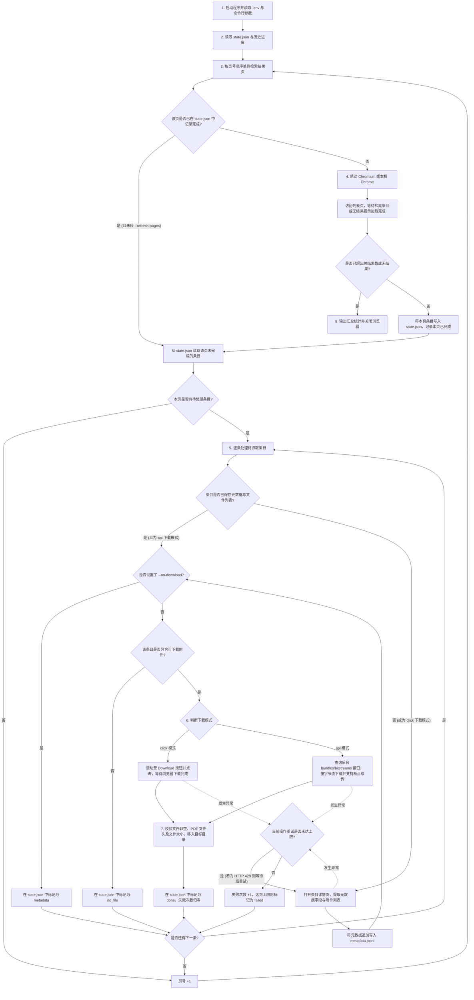

# Parliament Digital Library Crawler

基于 Playwright 的印度议会数字图书馆（`https://elibrary.sansad.in`）检索结果与文献附件抓取工具。程序按页访问检索结果列表，依次打开每条文献的详情页提取元数据，并通过页面点击或后台接口下载对应的 PDF 附件。抓取进度保存在 `state.json` 中，支持中断后继续运行。

## 功能说明

### 运行逻辑与功能结构图



### 按运行顺序的功能说明

1. **读取配置与本地记录（`crawler/run.py`、`crawler/state.py`）**
   - 启动时读取项目根目录下的 `.env` 文件与命令行参数，确定检索地址、数据目录（`--data-dir`）与附件保存目录（`--output-dir`）。
   - 读取数据目录下的 `state.json`。若当前指定的检索地址（`--search-url`）或每页条数（`--page-size`）与 `state.json` 中已有记录不一致，程序会在终端输出提示。
2. **启动浏览器会话（`crawler/browser.py`）**
   - 若指定了 `--chrome-binary`（或环境变量 `PDL_CHROME_BINARY`），直接启动该路径对应的浏览器。
   - 未指定时，优先启动 Playwright 安装的 Chromium；若未安装 Playwright Chromium，则尝试启动本机已安装的 Google Chrome。
   - 创建浏览器上下文时注入初始化脚本（`crawler/stealth.py`），将 `navigator.webdriver` 设为 `undefined`，补充 `navigator.languages` 与 `window.chrome.runtime` 属性，并在打开页面后自动检查和关闭站点底部的 Cookie 弹窗。
3. **加载检索结果列表页与判断尾页（`crawler/pages.py`）**
   - 按页号拼接 URL 中的 `spc.page`（页号）与 `spc.rpp`（每页条数，默认 100），同时保留原检索 URL 中的其他查询参数（包括同名多值过滤参数）。
   - 若某一页在 `state.json` 中已标记完成且包含条目记录，默认直接从 `state.json` 读取该页条目，不再打开浏览器请求列表页（传入 `--refresh-pages` 时会重新请求）。
   - 访问列表页时，等待页面加载动画结束且每页卡片数量稳定，并在期间分步向下滚动页面。提取每条检索结果的 UUID、标题、详情页链接、年份、文献类型和关键词出现次数，同时从分页栏（如 `Showing 1 - 100 of 36376`）读取总结果数。
   - 当分页栏显示的总条数小于当前页起始序号，或页面出现 `Your search returned no results` 文字时，判定已到达最后一页并停止翻页；若因加载超时未拿到结果，则抛出异常并进入重试流程，不会将该页记为空页。
4. **提取条目详情页元数据（`crawler/pages.py`）**
   - 打开条目详情页（`/items/<uuid>`），等待详情字段块（`.simple-view-element`）加载完成。
   - 从页面读取全部元数据键值对（如 `Title`、`Members`、`Lok Sabha Number`、`Year of Publication`、`URI` 等）以及附件区域列出的文件名和预期文件大小。
   - 提取完成后将完整记录追加写入 `metadata.jsonl`。若在 `--download-mode api` 模式下重跑已有元数据的未完成条目，程序直接复用 `state.json` 中已保存的文件列表，不再重复打开详情页和重复写入 `metadata.jsonl`。
5. **模拟鼠标移动、滚轮滚动与点击（`crawler/stealth.py`）**
   - 记录当前标签页上一次鼠标停留的坐标，下次移动鼠标时从该坐标出发，不从 `(0, 0)` 重新开始。
   - 滚动页面时调用 `page.mouse.wheel()` 分多次滚动，每次滚动的距离和停顿时间在一定范围内随机变化，并伴随小幅度的鼠标位置偏移与偶发的向上回滚。
   - 点击按钮（如隐私弹窗确认按钮或附件 `Download` 按钮）时，先将按钮滚入可视区域，再沿三阶贝塞尔曲线分步移动鼠标至按钮内部随机位置，短暂悬停后检查该坐标点是否被页面顶栏或浮层遮挡：未被遮挡时执行鼠标按下与抬起操作，被遮挡时改为调用 DOM 元素的 `click()` 方法。
6. **下载条目附件（`crawler/download.py`）**
   - 支持两种下载方式：
     - **`click` 模式（默认）**：先检查页面上 `Download` 按钮的数量是否与解析出的附件数量一致；一致时按顺序点击对应按钮，通过 `page.expect_download()` 监听浏览器下载任务，监控临时文件字节增长并在下载完成后移入目标目录。若下载超过一定时间（默认 45 秒）字节数仍无变化，则取消当前下载并触发重试。
     - **`api` 模式**：复用浏览器当前会话的 Cookie，调用站点后台 DSpace REST 接口（`/server/api/core/items/<uuid>/bundles`）获取 `ORIGINAL` 捆绑包下的附件直链。单条目包含多个附件时，必须按文件名匹配对应直链（匹配不上则报错，防止下载错误文件）。使用 `requests` 按块流式写入 `.part` 临时文件，中断后重跑时通过 HTTP `Range` 请求从已有 `.part` 字节处继续下载；支持通过 `--concurrency` 设置同一条目内多附件的并发下载数（默认 3）。
7. **文件校验与同名文件处理（`crawler/download.py`）**
   - 过滤文件名中的非法字符并限制文件名长度。若同一条目下存在多个同名（或仅大小写不同）的附件，自动在后续文件名末尾追加 `_2`、`_3` 等序号，避免互相覆盖。
   - 下载完成后检查文件大小是否大于 0、`.pdf` 文件是否包含 `%PDF-` 文件头、非 HTML 文件是否误存了网页错误页，并核对实际下载字节数与响应头 `Content-Length` 及页面预期大小是否一致。校验通过后才将临时文件移动为正式文件。
8. **重试、频率限制处理与定期重启浏览器（`crawler/run.py`）**
   - 列表页加载、详情页解析或文件下载失败时，自动按递增间隔重试（默认单次运行内重试 3 次），重试前会关闭并重建浏览器会话。
   - 若检测到接口或页面返回 HTTP 429（请求频率限制），程序暂停等待（按 `60s`、`120s`、`240s` 递增，上限 300 秒）并重启浏览器后继续。
   - 每处理满一定数量条目（`--restart-every`，默认 200 条）主动重启一次浏览器，释放浏览器占用的内存。
   - 条目的累计失败次数（`attempts`）仅在整个条目处理失败时加 1，处理成功后归零；达到 `--max-retries`（默认 3 次）后标记为 `failed`。
9. **进度保存与中断退出（`crawler/state.py`、`crawler/run.py`）**
   - `state.json` 保存时先写入同目录下的 `.tmp` 临时文件并调用 `os.fsync()` 刷新到磁盘，再通过 `os.replace()` 替换原文件，避免写入中途断电或强制终止造成文件损坏。若启动时发现 `state.json` 已损坏無法解析，程序直接报错退出，不会覆盖原文件。
   - 运行中按下一次 `Ctrl+C` 时，程序会在当前条目处理完毕并保存 `state.json` 后退出；连续按两次 `Ctrl+C` 则立即终止。

## 环境要求

- Python 3.12 或更高版本
- [uv](https://docs.astral.sh/uv/)
- Playwright Chromium 或本机已安装的 Google Chrome
- 可访问 `https://elibrary.sansad.in` 的网络环境

## 安装与配置

```bash
git clone <repository-url>
cd Clawer_of_Parliament_Digital_Library
uv sync
cp .env.example .env
```

安装 Playwright Chromium（若本机已安装 Google Chrome 可跳过）：

```bash
uv run playwright install chromium
```

### 环境变量说明（`.env`）

程序启动时自动读取项目根目录下的 `.env` 文件（命令行同名参数优先级高于 `.env`）：

| 变量名 | 默认值 | 说明 |
| --- | --- | --- |
| `PDL_DATA_DIR` | `data` | 数据保存目录，存放 `state.json`、`metadata.jsonl` 及默认的 `files/` 子目录（等价于 `--data-dir`） |
| `PDL_OUTPUT_DIR` | 空（使用 `<PDL_DATA_DIR>/files`） | 可选：单独指定下载附件（PDF）的输出目录，临时中转目录为 `<PDL_OUTPUT_DIR>/.staging`（等价于 `--output-dir`） |
| `PDL_CHROME_BINARY` | 空（自动查找） | 可选：手动指定 Chrome 或 Chromium 可执行文件路径（等价于 `--chrome-binary`） |

## 运行与使用

```bash
# 仅抓取前 20 条的元数据，不下载附件
uv run pdl-crawl --max-items 20 --no-download

# 默认运行（click 模式顺序抓取并支持断点续跑）
uv run pdl-crawl

# 使用 DSpace REST 接口模式下载附件（支持 Range 断点续传）
uv run pdl-crawl --download-mode api

# 重试之前标记为 failed 的条目
uv run pdl-crawl --retry-failed

# 重新检查之前标记为 no_file 的条目
uv run pdl-crawl --recheck-no-file

# 重新请求已标记完成的列表页，用于发现新增或位置变动的条目（已完成的条目不会重复抓取详情页）
uv run pdl-crawl --download-mode api --refresh-pages
```

退出码：`0` 本次范围内的条目全部处理成功；`1` 存在处理失败的条目；`130` 用户通过 `Ctrl+C` 中断运行。

### 命令行参数说明

| 参数 | 默认值 | 说明 |
| --- | --- | --- |
| `--search-url URL` | `query=china` 检索地址 | 搜索结果页 URL |
| `--data-dir DIR` | 读取 `PDL_DATA_DIR` 或 `data` | 存放 `state.json` 与 `metadata.jsonl` 的目录 |
| `--output-dir DIR` | 读取 `PDL_OUTPUT_DIR` 或 `<data-dir>/files` | 下载附件（`<output-dir>/<uuid>/*.pdf`）的存放目录 |
| `--page-size N` | `100` | 列表页每页条数（对应 URL 参数 `spc.rpp`） |
| `--start-page N` | `1` | 起始页码（从 1 开始） |
| `--max-pages N` | 不限制 | 本次运行最多处理的列表页数 |
| `--max-items N` | 不限制 | 本次运行最多处理的条目数 |
| `--no-download` | 关闭 | 只抓取详情页元数据，不下载附件（条目状态记为 `metadata`） |
| `--download-mode {click,api}` | `click` | `click` 为点击页面下载按钮，`api` 为请求后台接口流式下载 |
| `--api-base URL` | `https://elibrary.sansad.in/server/api` | `api` 模式使用的 DSpace REST 接口根地址 |
| `--concurrency N` | `3` | `api` 模式下同一条目内多个附件的并发下载线程数 |
| `--delay SEC` | `1.0` | 条目之间的基础等待秒数（实际等待带 `±30%` 随机浮动） |
| `--page-retries N` | `3` | 单个条目或列表页在一次运行内的最大尝试次数 |
| `--max-retries N` | `3` | 跨多次运行累计失败多少次后将条目标记为 `failed` |
| `--retry-failed` | 关闭 | 重新处理状态为 `failed` 的条目 |
| `--recheck-no-file` | 关闭 | 重新访问状态为 `no_file` 的条目，检查是否有遗漏附件 |
| `--refresh-pages` | 关闭 | 忽略 `state.json` 中的列表页完成标记，重新抓取列表页 |
| `--restart-every N` | `200` | 每处理 `N` 个条目重启一次浏览器 |
| `--page-load-timeout SEC` | `120` | 浏览器导航超时时间（秒） |
| `--min-speed KBPS` | `50.0` | 根据文件预期大小估算最大下载耗时的基准速度（KB/s） |
| `--min-download-timeout SEC` | `300.0` | 单个文件下载耗时的下限（秒） |
| `--stall-timeout SEC` | `45.0` | `click` 模式下下载字节数无变化的最大等待时间（秒） |
| `--headed` | 关闭（默认无头模式） | 显示浏览器窗口 |
| `--chrome-binary PATH` | 读取 `PDL_CHROME_BINARY` | 指定 Chrome / Chromium 可执行文件路径 |

### 输出目录与数据格式说明

```text
<PDL_DATA_DIR>/
├── state.json            # 抓取进度：已处理的列表页、每个条目的状态与本地文件路径
├── metadata.jsonl        # 每行一个条目的元数据 JSON（追加写入）
├── .staging/             # click 模式下载过程中的临时目录（配置了 PDL_OUTPUT_DIR 时位于 <PDL_OUTPUT_DIR>/.staging）
└── files/<uuid>/*.pdf    # 按条目 UUID 分目录存放的附件（配置了 PDL_OUTPUT_DIR 时位于 <PDL_OUTPUT_DIR>/<uuid>/*.pdf）
```

`state.json` 中每个条目的 `status` 取值如下：

| 状态 | 含义 |
| --- | --- |
| `pending` | 已从列表页发现该条目，尚未完成详情页抓取（或上次失败后等待重试） |
| `metadata` | 已抓取详情页元数据并写入 `metadata.jsonl`，但尚未下载附件（如使用 `--no-download` 时） |
| `done` | 元数据提取与附件下载均已完成 |
| `no_file` | 详情页中没有可下载的附件（需传入 `--recheck-no-file` 才会重新检查） |
| `failed` | 累计失败次数达到 `--max-retries`，默认跳过（需传入 `--retry-failed` 才会重试） |

#### `metadata.jsonl` 单行 JSON 结构示例

```json
{
  "uuid": "e9cc647b-a5cc-4545-ab9c-e9ac187b9017",
  "url": "https://elibrary.sansad.in/items/e9cc647b-a5cc-4545-ab9c-e9ac187b9017",
  "list_page": 1,
  "year": "21-Sep-2020",
  "item_type": "Part 1(Questions And Answers)",
  "keyword_count": 218,
  "fields": {
    "Accession Date": ["28-jan-2025"],
    "Available Date": ["28-jan-2025"],
    "ISO Language": ["Original"],
    "Lok Sabha Number": ["17"],
    "Members": ["Rodmal Nagar", "Keshari Devi Patel"],
    "Ministry": ["ELECTRONICS AND INFORMATION TECHNOLOGY"],
    "Question Number": ["1665"],
    "Question Type": ["Unstarred"],
    "Session Number": ["IV"],
    "Title": ["Chinese Mobile Phones and Elecetronic Items"],
    "Type": ["Part 1(Questions And Answers)"],
    "URI": ["https://elibrary.sansad.in/handle/123456789/322087"],
    "Year of Publication": ["21-sep-2020"]
  },
  "files": [
    {
      "name": "AU1665.pdf",
      "size_text": "291.47 KB",
      "size_bytes_expected": 298465
    },
    {
      "name": "AU1665_hindi.pdf",
      "size_text": "308.28 KB",
      "size_bytes_expected": 315678
    }
  ],
  "scraped_at": "2026-08-06T11:31:42+0800"
}
```

字段含义：
- `uuid`：条目在 DSpace 系统中的唯一标识符
- `url`：条目详情页地址
- `list_page`：首次发现该条目时所在的检索列表页码
- `year`：列表页显示的出版或会议日期文本
- `item_type`：列表页显示的文献分类标签
- `keyword_count`：列表页显示的检索词出现次数（无该标记时为 `null`）
- `fields`：详情页展示的全部元数据字段字典，键为字段标题，值为字符串列表
- `files`：详情页列出的附件列表，每项包含文件名（`name`）、页面显示的文件大小文本（`size_text`）及换算后的字节数（`size_bytes_expected`）
- `scraped_at`：抓取该详情页时的本地时间戳（ISO 8601 格式）

### 历史数据校验与修复工具（`scripts/repair_data.py`）

用于检查数据目录中已有的 `state.json`、`metadata.jsonl` 与本地附件文件的一致性：

```bash
# 只读扫描并输出统计结果（不修改任何文件）
uv run python scripts/repair_data.py

# 备份 state.json.bak / metadata.jsonl.bak 后执行修复与去重
uv run python scripts/repair_data.py --apply
```

传入 `--apply` 时执行的处理包括：
1. 检查所有状态为 `done` 的条目对应的本地文件是否存在、是否为空文件、是否包含 `%PDF-` 文件头以及文件大小是否正常；将文件缺失或损坏的条目状态重置为 `metadata` 并删除损坏文件，以便后续运行 `uv run pdl-crawl` 时自动重新下载。
2. 将 `metadata.jsonl` 按 `uuid` 去重（保留每个 `uuid` 最后一次写入的记录）。
3. 将 `state.json` 中已下载文件的 `path` 字段统一更新为当前数据目录下的实际路径，并将历史 `attempts` 计数归零。

## 站点页面结构与后台接口说明

目标站点 `https://elibrary.sansad.in` 基于 DSpace 7（前端为 Angular 单页应用，后端为 DSpace REST API）构建：

1. **检索结果列表页（`/search`）**
   - 翻页参数：`spc.page`（页码，从 1 开始）、`spc.rpp`（每页条数）、`spc.sf`（排序字段，如 `keyword_count`）、`spc.sd`（排序方向，`DESC` 或 `ASC`）。
   - 页面结构：检索结果容器为 `ds-search-results`，单条结果为 `ds-item-search-result-list-element`，分页统计栏为 `ds-pagination`（文本格式为 `Showing 1 - 100 of 36376`）。当页码超出范围或无匹配结果时，页面显示 `Your search returned no results.`。
2. **文献详情页（`/items/<uuid>`）**
   - 元数据字段位于 `.simple-view-element` 容器内，其中 `.simple-view-element-header` 为字段名，`.simple-view-element-body` 为字段值。
   - 附件下载链接或按钮通常为 `ds-file-download-link` 或带 `bitstreams/` 路径的链接。
3. **DSpace REST 附件下载接口（`--download-mode api` 使用）**
   - 查询条目的资源包列表：`GET /server/api/core/items/<uuid>/bundles`
   - 查询 `ORIGINAL` 资源包下的文件列表：`GET /server/api/core/bundles/<bundle_uuid>/bitstreams?size=200`
   - 下载文件内容：`GET /server/api/core/bitstreams/<bitstream_uuid>/content`（支持 HTTP `Range: bytes=<offset>-` 断点续传请求）。

## 项目结构

```text
.
├── main.py                  # 程序入口（等价于 pdl-crawl 命令）
├── crawler/
│   ├── run.py               # 命令行参数、.env 加载、翻页与条目抓取主循环、重试与退出控制
│   ├── browser.py           # Playwright 浏览器启动、生命周期管理、隐私弹窗关闭
│   ├── stealth.py           # 浏览器自动化属性修改、鼠标移动轨迹、滚轮滚动与点击操作
│   ├── pages.py             # 检索列表页与文献详情页 DOM 解析、尾页判定
│   ├── download.py          # click 与 api 两种下载实现、断点续传、文件校验与同名去重
│   └── state.py             # state.json 与 metadata.jsonl 的读写与状态更新
├── scripts/
│   └── repair_data.py       # 历史数据校验、损坏条目重置与 metadata.jsonl 去重脚本
├── tests/
│   └── test_crawler.py      # 核心解析函数、流式下载分支、状态更新与配置加载的单元测试
├── .env.example             # 环境变量配置示例
├── pyproject.toml           # 项目依赖配置
└── uv.lock                  # 依赖版本锁定文件
```

运行单元测试：

```bash
uv run python -m unittest discover -s tests -v
```
